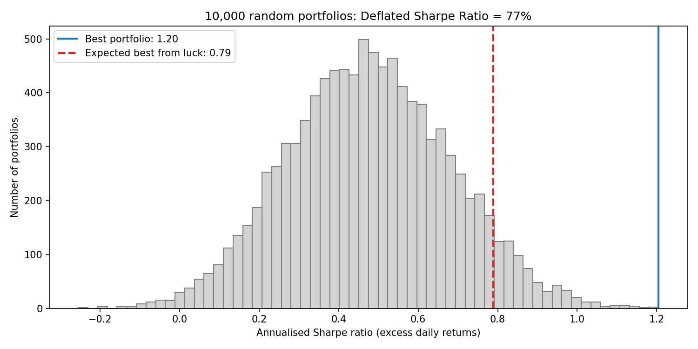

# Beauty & Fashion Stocks: Return and Risk Analyser

A Python project comparing the return and risk of **Indian and global beauty & fashion stocks**, and testing whether combining them builds a better portfolio.

**Author:** Apara Bhargava · BA (Hons.) Economics, Minor in Finance, Ahmedabad University
**Tools:** Python, pandas, NumPy, matplotlib, yfinance, Google Colab

## Question
How do Indian consumer-brand stocks (Honasa/Mamaearth, Nykaa, Trent) compare with global beauty and fashion leaders (e.l.f. Beauty, Estée Lauder, Coty, Tapestry, L'Oréal, LVMH) on return, risk and diversification?

## Data
- Daily adjusted closing prices from Yahoo Finance (via `yfinance`), **8 Nov 2023 to 5 Nov 2026** (closing prices, fixed end date so results are reproducible), with automatic data-quality checks and a split-error correction. The start date is the first full trading day after Honasa listed.
- All prices converted to **US dollars** using USD/INR and EUR/USD exchange rates, the view of a US-based investor.
- Benchmarks: S&P 500 and Nifty 50.
- Risk-free rate: 4.98% (US 10-year Treasury, Federal Reserve H.15, 29 Oct 2026).

## Method
1. Download prices and exchange rates; run data-quality checks (missing data, gaps, moves above 25%, exchange-rate ranges, split errors); fill exchange-holiday gaps; convert to US$.
2. Calculate daily returns.
3. For each stock: annual return (CAGR), annual volatility, Sharpe ratio and maximum drawdown.
4. Correlation heatmap to measure diversification within India, within global, and across the two.
5. Portfolios: equal-weight India, equal-weight global, equal-weight all, and 10,000 random portfolios to find the maximum-Sharpe and minimum-risk mixes (efficient frontier).
6. Overfitting test: Deflated Sharpe Ratio (Bailey & López de Prado, 2014) to check whether the best of 10,000 portfolios beats what luck alone would produce.

## Key findings
Period: 8 Nov 2023 to 5 Nov 2026 (closing prices), in US dollars.

1. **Only one of nine stocks beat the market after adjusting for risk.** Tapestry (Coach, Kate Spade) returned **70.5% a year** with a Sharpe ratio of **1.68**, vs **0.89** for the S&P 500. The other eight gave less return per unit of risk than simply buying the index.
2. **e.l.f. Beauty was the riskiest stock: 63% volatility and a 77% fall from its peak**, for just 3.7% a year. This matches my e.l.f. valuation project, where 91% of FY26 growth came from an acquisition and the core business grew 2%.
3. **Indian stocks did better than global ones.** Nykaa returned 26.4% a year (Sharpe 0.69) and Trent 17.5% (Sharpe 0.34); Honasa managed 8.0% with high risk (44% volatility, a 64% fall). The equal-weight India portfolio returned **21.6% a year vs 9.1%** for global. Coty was the worst stock: -26.2% a year and an 86% fall.
4. **Combining India and global stocks cut risk by about a fifth.** Indian stocks barely moved with global ones (average daily correlation **0.03**, vs **0.31** among global stocks and **0.19** among Indian stocks). An equal-weight mix of all nine had **20.7% volatility and a 33% worst fall**, vs 25.6% and 43% for India alone and 27.6% and 45% for global alone.
5. **The "optimised" portfolio looks great only with hindsight.** The best of 10,000 random mixes earned 30.7% a year (Sharpe 1.37), using L'Oréal 24%, Tapestry 23%, Nykaa 22% and Trent 18%. Its weights are chosen using the same data they are tested on.
6. **That best portfolio may be luck.** Its Sharpe ratio (1.26 on daily excess returns) beats the 0.82 that luck alone would produce from 10,000 tries, but the **Deflated Sharpe Ratio is only 78%**, below the 95% standard. With one try it would be 99%.
7. **Currency matters.** In US dollars the Nifty 50 returned 3.5% a year vs 18.2% for the S&P 500, partly because the rupee weakened against the dollar.
8. **Data checks caught a Yahoo Finance error.** Yahoo applied Trent's 1.5-for-1 stock split from 1 Jan 2026, creating a fake -33% day (exactly 1 / 1.5). I confirmed it against reported prices (real close ₹4,430 on 5 Jan 2026 vs Yahoo's ₹2,953 = ₹4,430 / 1.5) and the notebook now corrects such errors automatically. Before the fix, Trent wrongly showed +3.1% a year.

| Portfolio | Annual return | Volatility | Sharpe | Worst fall |
|---|---|---|---|---|
| Equal-weight India | 21.6% | 25.6% | 0.65 | -42.5% |
| Equal-weight Global | 9.1% | 27.6% | 0.15 | -45.4% |
| **Equal-weight All (India + Global)** | **14.9%** | **20.7%** | **0.48** | **-33.3%** |
| Optimised (max Sharpe, in-sample) | 30.7% | 18.7% | 1.37 | -17.9% |
| Minimum risk | 18.0% | 17.3% | 0.75 | -25.4% |

## Charts
| | |
|---|---|
|  |  |
|  |  |
|  | |

## Limitations
- Past returns do not predict future returns. Optimised weights are chosen and tested on the same data (in-sample).
- Short period (about 3 years), limited by Honasa's listing date.
- US$ conversion adds currency effects; no transaction costs or taxes.
- Random search finds a good portfolio, not the exact optimum.
- The 10,000 portfolios share the same 9 stocks, so the effective number of independent tries is lower; the Deflated Sharpe table shows results for 10 to 10,000 tries.
- Indian markets close before US markets open, so daily correlations between India and the US are understated; weekly returns would give a fairer measure.

## How to run
Open `Beauty_Fashion_Return_Risk_Analyser_v2_Final.ipynb` in Google Colab and choose **Runtime → Run all**.

## Related projects
1. Initiating coverage report on e.l.f. Beauty (Excel: DCF, comparable companies).
2. FP&A budget model for a model Indian D2C skincare brand (Excel).

*Educational project. Not investment advice.*
