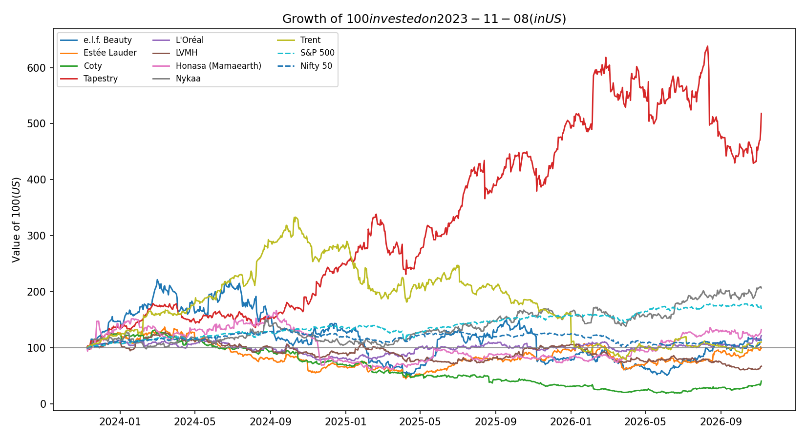
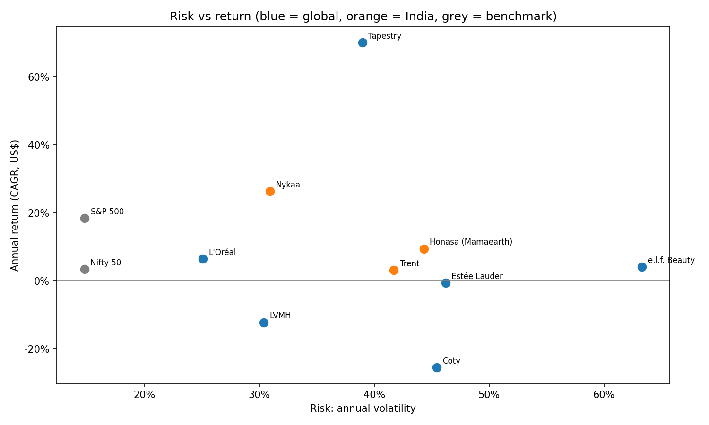
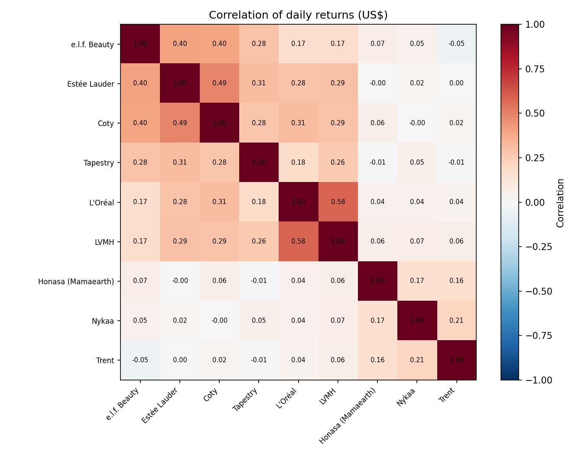
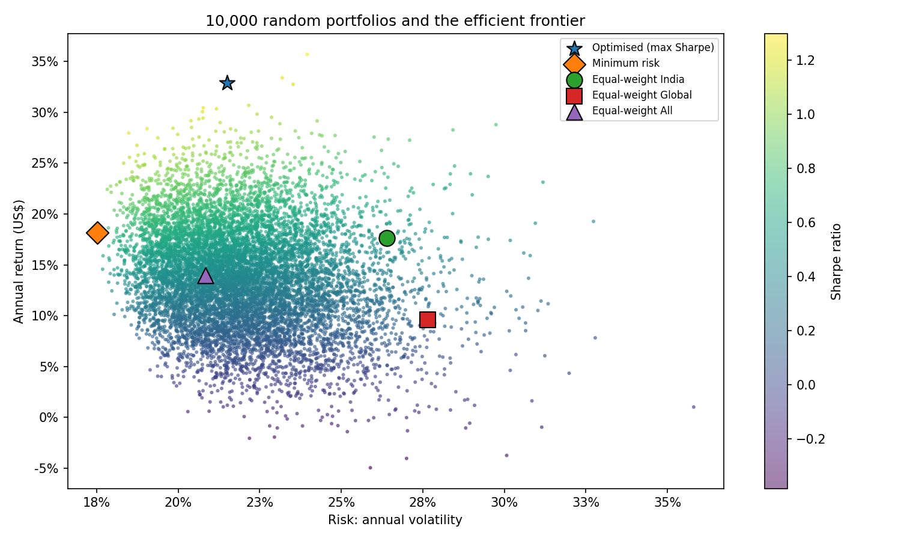

# Beauty & Fashion Stocks: Return and Risk Analyser

A Python project comparing the return and risk of **Indian and global beauty & fashion stocks**, and testing whether combining them builds a better portfolio.

**Author:** Apara Bhargava · BA (Hons.) Economics, Minor in Finance, Ahmedabad University
**Tools:** Python, pandas, NumPy, matplotlib, yfinance, Google Colab

## Question
How do Indian consumer-brand stocks (Honasa/Mamaearth, Nykaa, Trent) compare with global beauty and fashion leaders (e.l.f. Beauty, Estée Lauder, Coty, Tapestry, L'Oréal, LVMH) on return, risk and diversification?

## Data
- Daily adjusted closing prices from Yahoo Finance (via `yfinance`), **8 Nov 2023 to 5 Nov 2026**. The start date is the first full trading day after Honasa listed.
- All prices converted to **US dollars** using USD/INR and EUR/USD exchange rates, the view of a US-based investor.
- Benchmarks: S&P 500 and Nifty 50.
- Risk-free rate: 4.98% (US 10-year Treasury, Federal Reserve H.15, 29 Oct 2026).

## Method
1. Download prices and exchange rates; fill exchange-holiday gaps; convert to US$.
2. Calculate daily returns.
3. For each stock: annual return (CAGR), annual volatility, Sharpe ratio and maximum drawdown.
4. Correlation heatmap to measure diversification within India, within global, and across the two.
5. Portfolios: equal-weight India, equal-weight global, equal-weight all, and 10,000 random portfolios to find the maximum-Sharpe and minimum-risk mixes (efficient frontier).

## Key findings
Period: 8 Nov 2023 to 5 Nov 2026, in US dollars (5 Nov prices for US stocks were taken during the trading day).

1. **Only one of nine stocks beat the market after adjusting for risk.** Tapestry (Coach, Kate Spade) returned **70.2% a year** with a Sharpe ratio of **1.67**, vs **0.91** for the S&P 500. The other eight gave less return per unit of risk than simply buying the index.
2. **e.l.f. Beauty was the riskiest stock: 63% volatility and a 77% fall from its peak**, for just 4.2% a year. This matches my e.l.f. valuation project, where 91% of FY26 growth came from an acquisition and the core business grew 2%.
3. **Nykaa was the best Indian stock** (26.4% a year, Sharpe 0.69). Honasa (9.5%) and Trent (3.1%) carried high risk (42–44% volatility) and deep falls (Honasa −64%, Trent −76%). Coty was the worst: −25.5% a year and an 86% fall.
4. **Combining India and global stocks cut risk by about a quarter.** Indian stocks barely moved with global ones (average daily correlation **0.03**, vs **0.31** among global stocks and **0.18** among Indian stocks). An equal-weight mix of all nine had **20.8% volatility and a 33% worst fall**, vs 26.4% and 46% for India alone and 27.7% and 45% for global alone.
5. **The "optimised" portfolio looks great only with hindsight.** The best of 10,000 random mixes earned 32.9% a year (Sharpe 1.30), but it put 35% in Tapestry, the stock that had already done best. Its weights are chosen using the same data they are tested on.
6. **Currency matters.** In US dollars the Nifty 50 returned 3.5% a year vs 18.5% for the S&P 500, partly because the rupee weakened against the dollar.

| Portfolio | Annual return | Volatility | Sharpe | Worst fall |
|---|---|---|---|---|
| Equal-weight India | 17.6% | 26.4% | 0.48 | −46.0% |
| Equal-weight Global | 9.6% | 27.7% | 0.17 | −45.4% |
| **Equal-weight All (India + Global)** | **14.0%** | **20.8%** | **0.43** | **−33.3%** |
| Optimised (max Sharpe, in-sample) | 32.9% | 21.5% | 1.30 | −18.7% |
| Minimum risk | 18.1% | 17.5% | 0.75 | −25.1% |

## Charts
| | |
|---|---|
|  |  |
|  |  |

## Limitations
- Past returns do not predict future returns. Optimised weights are chosen and tested on the same data (in-sample).
- Short period (about 3 years), limited by Honasa's listing date.
- US$ conversion adds currency effects; no transaction costs or taxes.
- Random search finds a good portfolio, not the exact optimum.
- Indian markets close before US markets open, so daily correlations between India and the US are understated; weekly returns would give a fairer measure.

## How to run
Open `Beauty_Fashion_Return_Risk_Analyser.ipynb` in Google Colab and choose **Runtime → Run all**.

## Related projects
1. Initiating coverage report on e.l.f. Beauty (Excel: DCF, comparable companies).
2. FP&A budget model for a model Indian D2C skincare brand (Excel).

*Educational project. Not investment advice.*
